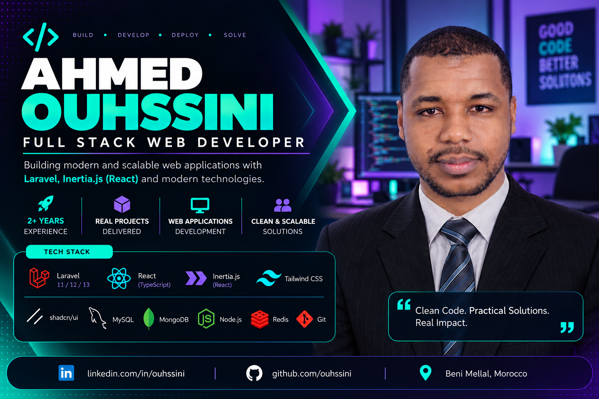

<!-- <h1 align="center">Hi 👋, I'm Ouhssini Ahmed</h1>
<h3 align="center">A passionate FullStack developer from Morocco</h3> -->

  
<!-- 
  
 -->

<!-- 
  
 -->

<h3 align="left">Connect with me:</h3>

<!--  -->

<!-- <table>
  <tr>
    <td>
      
    </td>
    <td>
      
    </td>
    
  </tr>
</table> -->

